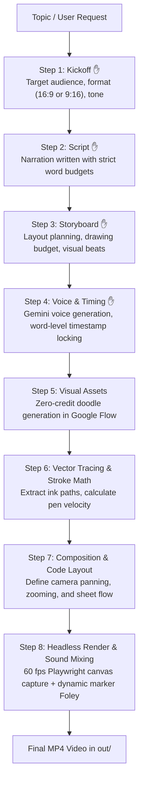

# Whiteboard Explainer: AI Agent Skill

[](LICENSE)
[](INSTALL.md)
[](INSTALL.md)

Give your AI coding agent a topic and get a fully animated, RSA-style whiteboard explainer video. A realistic human hand draws every visual element and writes every label, timed word-by-word down to the millisecond to natural voice narration—rendered directly to MP4 with no manual video editing required.

---

## 🌟 Key Capabilities

- 🖋️ **Realistic Hand Drawing Engine**: Stroke-by-stroke vector path animation with natural hand motion and realistic ink drawing dynamics.
- ⏱️ **Word-Clock Audio Sync & Speech Models**: Speech transcribed and timed to the exact syllable with `faster-whisper`. Supports multiple Whisper model sizes (`base`, `small`, `medium`, `large-v3`, `tiny`).
- 🔊 **Procedural Audio & Marker Squeaks**: Physically modeled dry-erase marker stick-slip squeaks, felt friction, adaptive speech ducking, and harmonic ambient music beds.
- 🎨 **Bundled Flow Studio MCP**: Includes the complete, updated Google Flow MCP companion with multi-server parallel generation (`Flow Studio - New Window.cmd`) and multi-key pooling.
- 🎙️ **Multi-Model Gemini TTS with Key Rotation**: Generates human-like voice narration across multiple allowed models (`gemini-2.5-flash-preview-tts`, `gemini-2.0-flash`, `gemini-1.5-flash`, `gemini-2.5-pro`) with automated multi-key pool failover and quota management.
- 🤖 **Cross-Agent Compatible**: Built to open agent skill standards—plugs into **Claude Code**, **Antigravity**, **OpenAI Codex**, **Cursor**, **OpenCode**, and **Gemini CLI**.
- 🖥️ **Full Cross-Platform Support**: Tested and running on Windows (PowerShell/CMD), macOS, and Linux.

---

## 🚀 Quick Start

### 1. Clone & Install Globally
```bash
git clone https://github.com/Blackhawkup/Whiteboard-Skill.git
cd Whiteboard-Skill

# Install the skill to all detected agents on your computer:
python3 scripts/install.py        # macOS / Linux
# or: python scripts\install.py   # Windows
```

### 2. Bootstrap Dependencies
Run the automated environment installer:
```bash
./scripts/wb setup --install       # macOS / Linux
# or: .\scripts\wb.cmd setup --install  # Windows
```
*This configures the isolated Python venv, installs FFmpeg/Playwright requirements, builds Flow Studio MCP (`flow-mcp`), and registers the MCP server in your agents.*

For detailed, operating-system-specific installation guides and troubleshooting, see [**INSTALL.md**](INSTALL.md).

### 3. Generate a Video
Start a new chat with your agent (Claude Code, Antigravity, Cursor, etc.) and say:

> *"I want to create a whiteboard explainer video. The topic is: How Neural Networks Learn."*

Your agent will follow the skill workflow, asking for your approval at key milestones (script, storyboard, and voice) before rendering the final film.

---

## 🎬 How the Production Pipeline Works



---

## 🛠️ CLI Reference (`wb`)

The `wb` command-line utility orchestrates the entire skill workspace (default `~/WhiteboardFilms` or `%USERPROFILE%\WhiteboardFilms`):

| Command | Description |
|---|---|
| `wb setup [--install]` | Check dependencies; `--install` automatically fixes missing components |
| `wb example [chatbot-vs-agent]` | Copies bundled sample film and renders proof-of-life sheets |
| `wb new <slug> [--format 16:9\|9:16\|1:1]` | Creates a new film workspace from template |
| `wb prompts <film>` | Generates Google Flow prompts from `drawings.json` and film style |
| `wb intake <film> name=file ...` | Imports generated illustrations into the film folder |
| `wb hand <image> [--tip x,y]` | Generates a custom hand silhouette and pen tip calibration |
| `wb art <film> [name ...]` | Traces raster drawings into vector pen stroke paths |
| `wb labels <film>` | Renders and traces text labels into handwritten vector strokes |
| `wb tts <film> --voice <name> [--model <model>]` | Generates voice narration via Google AI Studio API with model and key auto-failover |
| `wb voice <film> <audio.wav> [--whisper-model <m>]` | Transcribes audio and locks word timestamps with `faster-whisper` (`base`, `small`, `medium`, `large-v3`) |
| `wb check <film>` | Validates pen speeds, layout boundaries, cut edges, and collisions |
| `wb sheet <film>` | Generates visual contact sheets for quick storyboard review |
| `wb preview <film>` | Compiles a quick low-resolution draft with audio |
| `wb make <film> [--force]` | Runs complete 60 fps headless capture and audio mix into final MP4 |

---

## 📂 Project Structure

```
Whiteboard-Skill/
├── SKILL.md              # Core agent instruction file & workflow rules
├── README.md             # Repository documentation & guide
├── INSTALL.md            # Comprehensive OS & agent setup instructions
├── AGENTS.md             # Pointer instruction for multi-agent frameworks
├── .gitignore            # Clean git exclusion rules
├── flow-mcp/             # Bundled Flow Studio MCP server & multi-instance UI
│   ├── src/              # MCP core, Gemini TTS rotator & server orchestration
│   ├── studio/           # Web UI companion with key pool & parallel launcher
│   └── Flow Studio*.cmd  # Windows one-click and multi-instance launchers
├── scripts/
│   ├── install.py        # Global cross-agent installer script
│   ├── wb                # Unix CLI runner script
│   └── wb.cmd            # Windows CMD/PowerShell runner script
├── tools/
│   ├── wb.py             # CLI command dispatcher with multi-model flags
│   ├── setup.py          # Dependency checker & automatic installer
│   ├── voice.py          # Multi-model TTS generator & Whisper word timer
│   ├── strokes.py        # Raster-to-vector ink path tracer
│   ├── render.py         # Headless Playwright/Chrome frame capture & video encoder
│   ├── mix.py            # Procedural marker squeaks, Foley & audio mixer
│   ├── hand.py           # Hand cutout mask & pen calibration
│   ├── prompts.py        # Style-conditioned image prompt generator
│   ├── check.py          # Quality and geometry validation checks
│   ├── build.py          # Web engine packaging
│   └── common.py         # Shared configuration and system path resolver
├── engine/
│   ├── wb.js             # Canvas animation runtime engine
│   └── fonts/            # High-legibility web fonts (Caveat, Inter, Geist, etc.)
├── assets/
│   └── hand/             # Default hand assets and tip coordinate map
├── templates/
│   └── film/             # Starter templates for film config, scene, and script
├── reference/
│   ├── kickoff.md        # Kickoff question guidelines
│   ├── writing.md        # Script length, pacing, and word rules
│   ├── storyboard.md     # Visual board composition rules
│   ├── voice.md          # Voice styling and API key configuration
│   ├── prompts.md        # Image prompt recipes for doodle art
│   ├── scene-api.md      # JavaScript scene animation API reference
│   ├── review.md         # Review guidelines and revision strategies
│   └── setup.md          # Internal setup reference
└── examples/
    ├── chatbot-vs-agent/ # Complete 16:9 landscape reference video
    └── one-key/          # Complete 9:16 vertical short/reel reference video
```

---

## 📄 License & Attribution

- **Code & Synthesizer**: MIT License. Original procedural audio synthesizer and rendering engine.
- **Fonts**: Bundled under the SIL Open Font License (SIL OFL) — Caveat, Inter, Geist, Archivo Black, and Instrument Serif.
- **Third-Party Services**: Images generated via Google Flow and voices generated via Google AI Studio comply with Google's respective Terms of Service.
